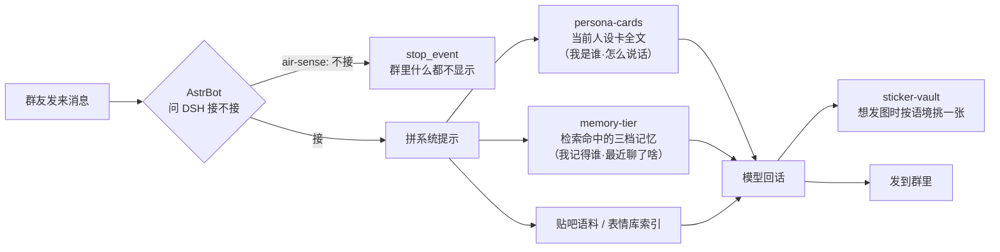

# dsh-plugins

给 [DeepSeek Harness](https://github.com/deepseek-ai) 写的几个小插件，专门伺候「QQ 群里那只 AI」这件事。

四个插件各管一段，拼起来是完整的一条链：**谁在说（人设卡）→ 记不记得（三档记忆）→ 这句该不该接（读空气）→ 用什么表情（表情库）**。

| 插件 | 管什么 | 一句话 |
| --- | --- | --- |
| [dsh-persona-cards](https://github.com/yingchaoyi/dsh-persona-cards) | 人设卡 | 我是谁、怎么说话。多套人格存着，点「使用」就换个人 |
| [dsh-memory-tier](https://github.com/yingchaoyi/dsh-memory-tier) | 三档记忆 | 该记的记住，该忘的忘掉，每轮只注入相关的那几条，省 token |
| [dsh-air-sense](https://github.com/yingchaoyi/dsh-air-sense) | 读空气 | 这条消息值不值得接，不值得就闭嘴——群里的 AI 最招人烦的是每句都接 |
| [dsh-sticker-vault](https://github.com/yingchaoyi/dsh-sticker-vault) | 表情包库 | 群友的梗图先收着，重复到次数就入库，对喷时按语境捞出来发 |

## 一条群消息的旅程



四者互不调用，只在两个地方有交集：

1. **系统提示里排队**。`persona-cards` 挂在 `order: 900`，`memory-tier` 挂在 `order: 910`——先定「我是谁」，再看「我记得什么」。两张都走 `systemPrompt.context`，每轮一条、内容变了才追加，不会把整段系统提示的缓存打废。
2. **air-sense 是闸门，不参与回话**。它只回答「接 / 不接 / 复读 / 戳回去」，不做生成。接不接跟记忆、人设都没关系，所以放最前面：不接的话后面三个插件一个 token 都不用花。

## 分工的边界（为什么是四个，不是一个）

| | persona-cards | memory-tier |
| --- | --- | --- |
| 内容 | 「我是谁、怎么说话」 | 「我记得谁、发生了什么」 |
| 数量 | 少而重（一张顶用） | 多而散（天天在长） |
| 变化频率 | 一改就是换个人 | 每轮都在读写 |
| 谁说了算 | 主人手写 | 模型自己记 + 主人删改 |

以前这两件事都塞在 `dsh-memory-tier` 里，改人设得跟记忆参数挤一块，还容易被字数预算截断。拆开之后：人设卡给足篇幅（两万字），记忆那边腾出的预算全给记忆。

`dsh-air-sense` 和 `dsh-sticker-vault` 则是纯外向的：一个管「说不说」，一个管「发什么图」，跟记忆、人设都没有状态上的耦合。

## 一起装

```bash
dsh plugin --profile web add github:yingchaoyi/dsh-persona-cards
dsh plugin --profile web add github:yingchaoyi/dsh-memory-tier
dsh plugin --profile web add github:yingchaoyi/dsh-air-sense
dsh plugin --profile web add github:yingchaoyi/dsh-sticker-vault
```

也可以只装一个，在插件页里填包名。装完刷新页面，设置里会多出「人设卡」「三档记忆」「读空气」「表情库」四块。

| 插件 | 面板 | 数据 |
| --- | --- | --- |
| dsh-persona-cards | 人设卡：列表 / 使用 / 新建 / 编辑 / 删除 | `~/.dsh/persona-cards/store.json` |
| dsh-memory-tier | 三档记忆：按群分库 / 每档增删改用 / 预览这一轮注入什么 | `~/.dsh/memory-tier/store.json` |
| dsh-air-sense | 读空气：概览 / 规则（49 项）/ 日志 / 设置 | `~/.dsh/air-sense/store.json` |
| dsh-sticker-vault | 表情库：入库图 / 候选 / 描述标签 / 上锁 | `~/.dsh/sticker-vault/` |

数据都在 `~/.dsh/` 下，删目录就干净了。

---

## dsh-persona-cards

一套人设存成一张卡：名字 + 正文（两万字以内）。点「使用」，下一轮就按这张卡说话；点「停用」，回到模型默认。

- 多套人格并存，卡可以新建、编辑、删除，旧的留着不删
- 只注入**当前这张**，没在用就一个字都不注入
- 正文随便写：分章节、写口癖、写弹药库、写红线都行
- 自带一张 `presets/大肥鱼.md`，`node scripts/seed.mjs` 就能灌进去

## dsh-memory-tier

三档记忆，全部本地：

- **长期**——永久，只放最关键的东西：群友是谁、什么脾气、什么关系、什么生日，还有主人定的规矩。带 🔒 的是「底稿」，群友怎么说都不许改，用来防编。
- **中期**——默认 30 天，满了按重要性淘汰。
- **短期**——默认 4 天，群里最近聊的梗和事，用来接话不掉线。
- **群会话自动重置**——可开关，按「空闲多久」（天/小时/分钟）把老会话解绑归档，省 token；旧会话还能用 `/dsh use` 接回来。

不回读整段聊天记录，按当轮问题做关键词检索，只注入命中的几条（有硬字数预算），所以又快又省。每条都能手动改、删、锁；面板里能看这一轮到底会注入什么，按 QQ 群分库、互不可见。

工具：`mem_note` / `mem_search` / `mem_forget` / `mem_stats`

## dsh-air-sense

给群聊里的 AI 装一道闸：**这条消息现在值不值得接**。

- AstrBot 收到群消息先送到 DSH 问一句，不接就 `stop_event()`，群里什么都看不到，也不花回复的 token
- 完整漏斗：开关 / 黑白名单 / 闭麦 / 指令 / 戳一戳 / 关键词 / 静默时段 / @老子硬过 / @别人硬拦 / 刷屏氛围 / 活跃度 / 日时额度 / 同人冷却 / 概率 / 密度 / 自适应分数
- 概率 = 基础 × 回复加成 × 注意力 × 戳戳增值 × 表情衰减 × 密度衰减 × 自适应分数，过了才掷骰子，还拿不准再问一次判断模型
- 自适应：有人接 +15、没人理 −8、每天衰减 2，频率自己贴合每个群
- **复读**：可开关，同一句话连着出现 N 次（默认 3）就原样跟一句，不过模型、不占额度、不进会话；撤回/入群/拍一拍这类系统提示不打断阵型
- 面板四页：概览 / 规则（49 项全带说明）/ 日志（搜索 + 分页）/ 设置；右上角总开关，关掉彻底不插手
- 判定失败、超时、插件挂了一律 fail-open——退回 AstrBot 原逻辑，不会把群聊憋死

需要配合 AstrBot 侧 `astrbot_plugin_dsh` 打个小补丁（README 里写了改哪几处）。

## dsh-sticker-vault

表情包库：

- 群友发图先落盘（按 sha256 去重）→ 同一张重复出现就计数 → 到阈值（默认 5）自动入库
- 入库时记着：谁发的、用过几次、当时在聊什么（最多 6 条语境）
- 每人最多 3 张、全库 50 张，超了挤掉计数最低的；**上锁**的挤不掉也删不掉
- 计数每 5 天清零；库里的图重置成 2 次起算，比新候选多一点起跑优势
- 面板能改描述/标签、上传、删除、搜索；候选区能手动收或扔

工具：`sticker_pick`（按语境/关键词/人挑图）/ `sticker_note` / `sticker_stats`

---

## 为什么都做成插件

- 装/卸就是加一行依赖，不想要了直接删；
- 面板挂在设置里，参数自己调，不用改代码；
- 数据都在 `~/.dsh/` 下，删目录就干净了；
- 四个插件之间没有硬依赖：只装 persona-cards 也能用，只是没记忆；只装 air-sense 也能用，只是回的每句话都是默认人格。

## License

MIT © 2026 yingchaoyi
